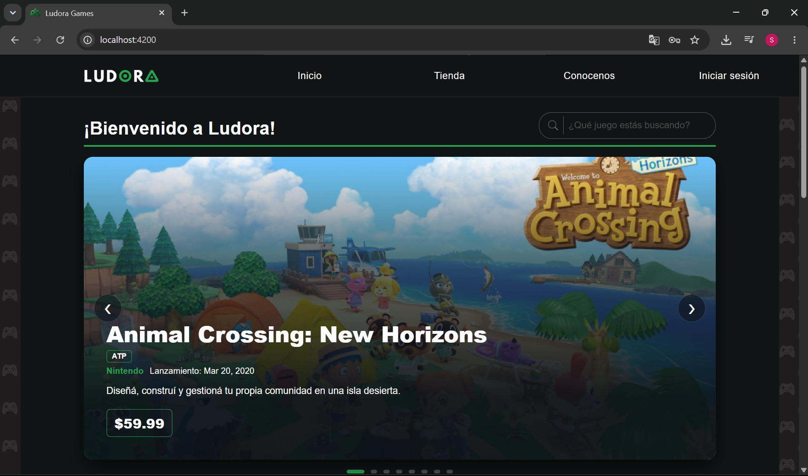
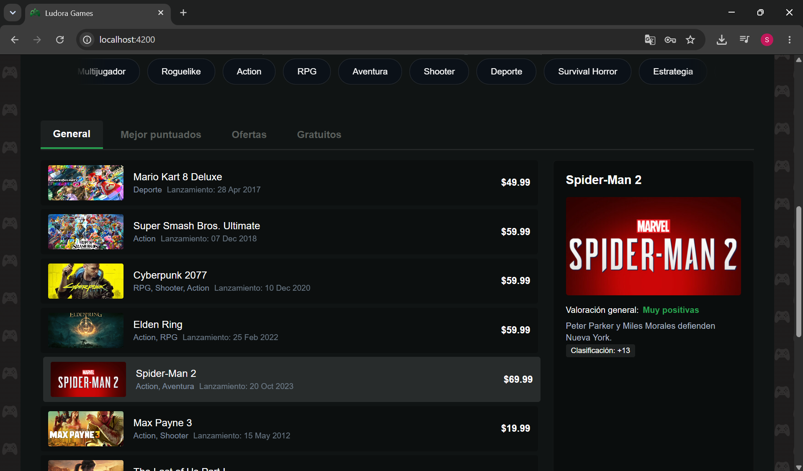
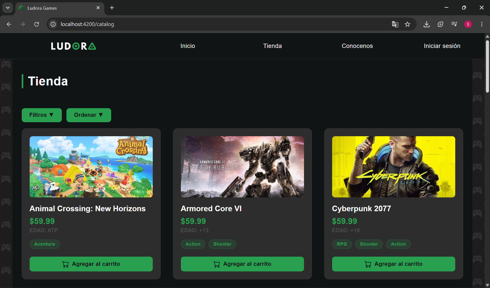
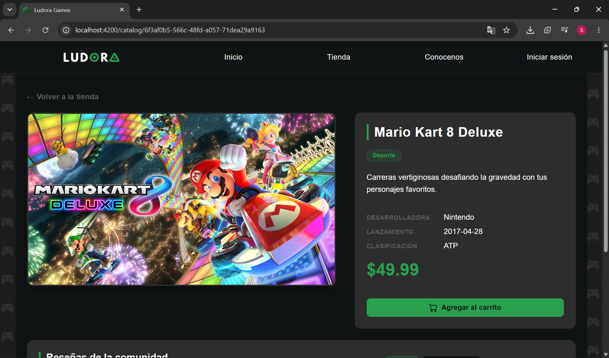
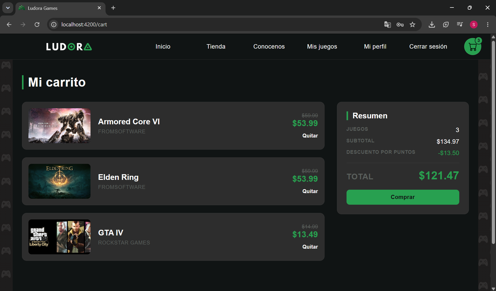
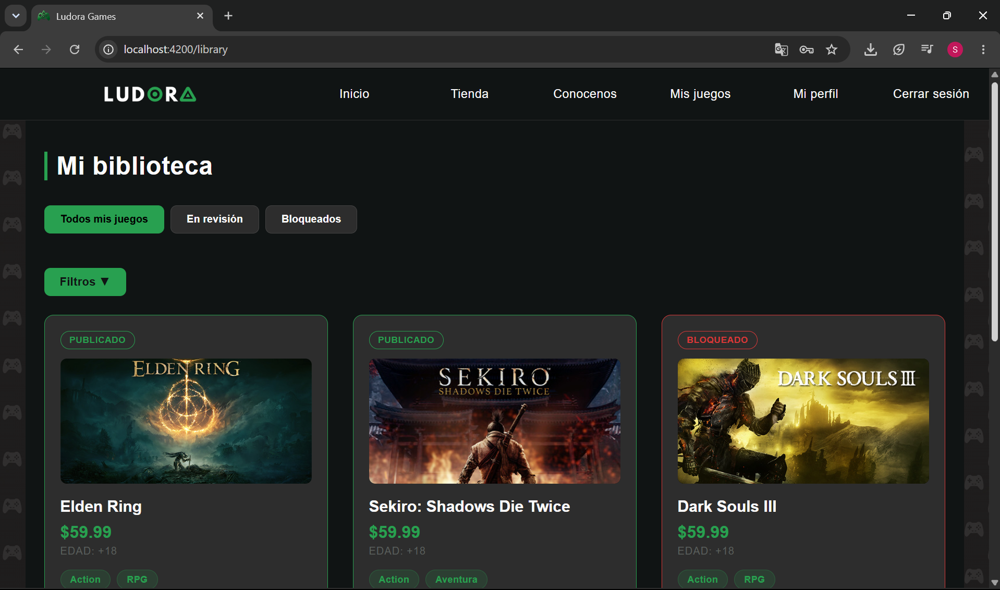
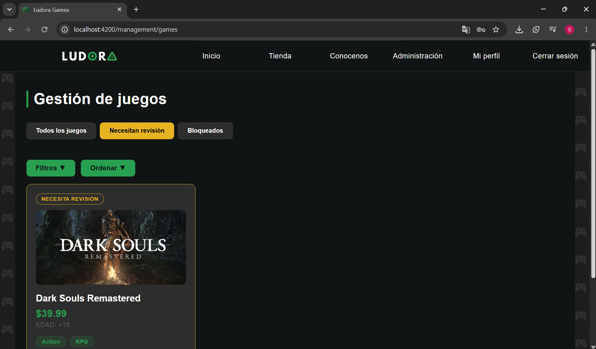

# Ludora – Frontend

**Ludora** is a web-based video game marketplace where developers can publish their games, clients can purchase them and write reviews, and administrators can moderate content. Purchases earn points that can be redeemed for discounts.

This repository contains the frontend, built with **Angular**. It communicates with the backend (Spring Boot) through a REST API.

## Features

**For all visitors**

- Game catalog with pagination, filters (name, price, release dates, genre, age rating, developer), and sorting.
- Game details with user reviews.
- User registration and login.

**Clients**

- Shopping cart with a header preview and on-screen notifications.
- Integration with Mercado Pago for payments.
- Purchased games library with filtering options.
- Reviews for owned games.
- Loyalty points system with redeemable discounts.

**Developers**

- Create and edit games (games remain under review until approved by an administrator).
- Game management dashboard with games organized by status: all, under review, and blocked.

**Administrators**

- Game management: approve, block, and unblock games, with views organized by status.
- User management (clients and developers): user listings, blocking, and unblocking.
- Sales overview.

## Technologies
- **Frontend:** Angular 22, TypeScript, RxJS.
- **UI:** Standalone components, Signals, custom HTML and CSS.
- **Integrations:** Mercado Pago, Cloudinary.
- **Deployment:** Docker and Nginx.

## Related Repository
- [Ludora Backend](https://github.com/emapaez2208/Ludora/tree/main/backend)

## Prerequisites
- Node.js 24.
- npm
- Angular CLI: `npm install -g @angular/cli`
- Ludora backend running at `http://localhost:8080`

## Installation and Setup
```bash
# 1. Clone the repository
git clone https://github.com/emapaez2208/Ludora.git
cd Ludora/frontend

# 2. Install dependencies
npm install

# 3. Start the development server
ng serve
```

The application will be available at http://localhost:4200.

### Backend Connection

In development, requests to `/api` are redirected to the backend through `proxy.conf.json`. If your backend runs on a different port, update the `target` value in that file.

## Running with Docker

From the root directory of the repository (where the `docker-compose.yml` file is located), run:

```bash
docker compose up --build
```

This starts the backend, database, and frontend.

To reset the database from scratch, run:

```bash
docker compose down -v
docker compose up --build
```

## Available Scripts
| Command |	Description |
|---|---|
| `ng serve` | Starts the development server with automatic page reload |
| `ng build` | Builds the project into the dist/ directory |
| `npm run build -- --configuration production` | Creates a production build |
| `ng test` | Runs unit tests |

## Project Structure

```
src/app/
├── components/     Reusable components (pagination, game 
│                   card, filter panel, sorting, notifications, reviews)
├── guards/         Role-based route protection
├── models/         Data interfaces (Game, Cart, Genre, filters, etc.)
├── pages/          Application pages
└── services/       API communication and shared state management
```

## Main Routes
| Route | Description | Access |
|---|---|---|
| `/` |	Home | Public |
| `/catalog` |	Game catalog | Public |
| `/catalog/:id` |	Game details | Public |
| `/login`, `/register` | Login and registration | Unauthenticated users |
| `/cart` | Shopping cart | Client |
| `/library` |	Game library | Client and developer |
| `/profile` | User profile | Authenticated users |
| `/games/new`, `/games/edit/:id` | Create and edit games | Developer |
| `/management/games` | Game management | Administrator |
| `/management/users` | User management | Administrator |
| `/management/sales` |	Sales overview | Administrator |

## User Roles
| Role | Description |
|---|---|
| `ROLE_CLIENT` | Purchases games and writes reviews |
| `ROLE_DEVELOPER` | Publishes and edits games |
| `ROLE_ADMIN` | Moderates games and user accounts |

Route access is controlled through guards (`authGuard`, `clientGuard`, `developerGuard`, `adminGuard`). All security and authorization checks are enforced by the backend.

## Team
- [Oscar Desimone](https://github.com/DESIMONE-DEV)
- [Germán Paez](https://github.com/germaniyo181818-lang)
- [Emanuel Paez Spognardi](https://github.com/emapaez2208)
- [Sofía Celeste Pagliaro](https://github.com/sofipagliaro)
- [Fernando Javier Suarez](https://github.com/Ferjs3)

## Screenshots

### Home




### Game Catalog


### Game Detail


### Shopping Cart


### Game Library - Developer


### Admin Game Management
